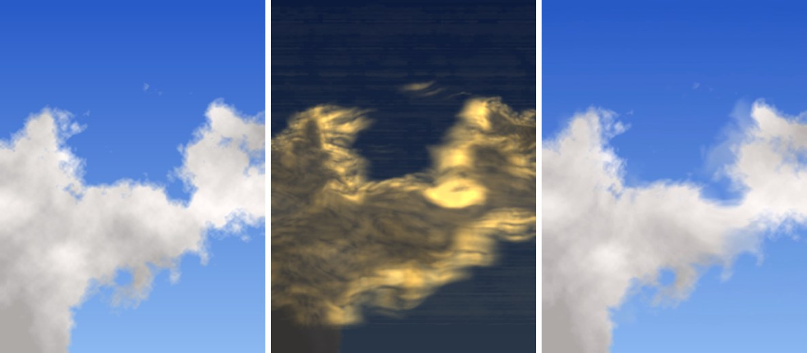
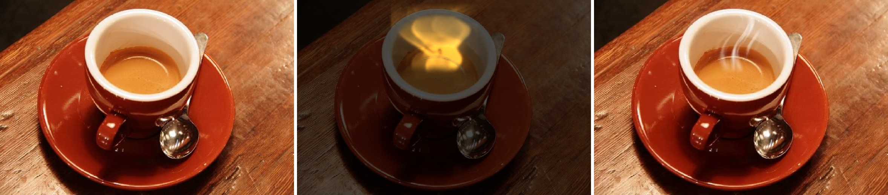
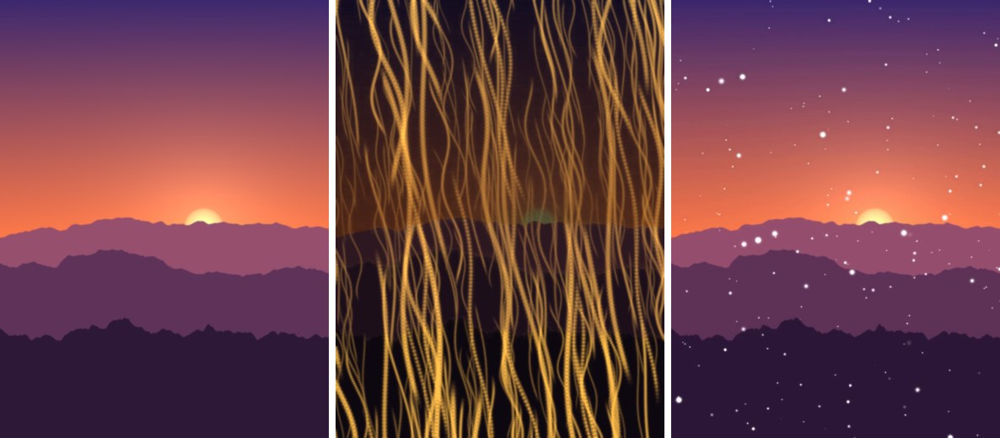
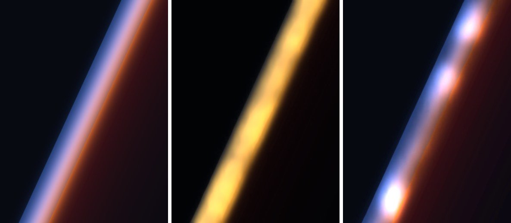
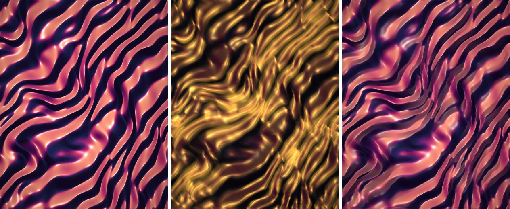
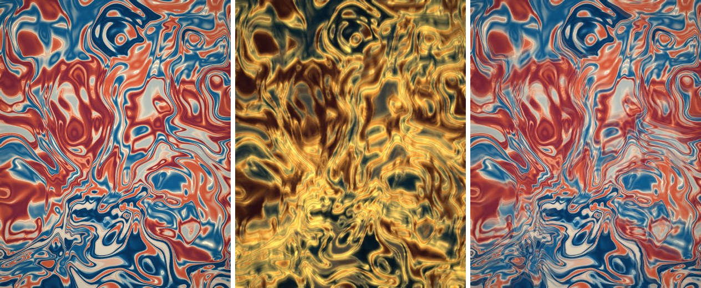
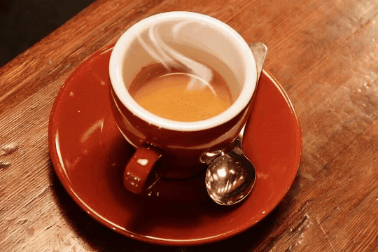
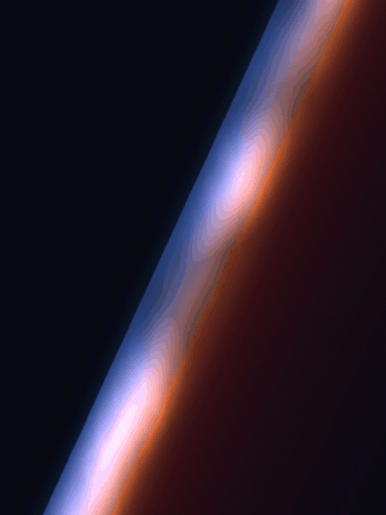
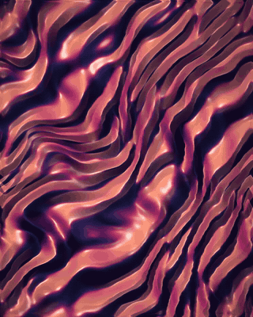
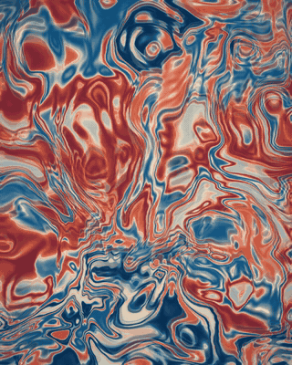

# stillmotion

A Claude skill that turns one still photo into a seamless looping cinemagraph: only the sky, the steam, the water or the light moves, the rest stays frozen.








Original, where it moves (brighter = more motion), one frame of the loop. Each example also has an MP4 and a small GIF in [`examples/`](examples/).







It is code, not a video model: a mask picks the moving area, a noise displacement field moves it, and two phases are blended so the last frame equals the first. Works on your own photos, drawings and abstract art (the silk and marbled ink examples are procedural images made in numpy).

## Use it with Claude

**claude.ai / Claude app:** download [`stillmotion-skill.zip`](stillmotion-skill.zip) and upload it in your skills settings. Then send Claude a photo and ask for a cinemagraph: "make only the clouds move".

**Claude Code:**

```bash
git clone https://github.com/thibaud360/stillmotion
cp -r stillmotion/skills/stillmotion ~/.claude/skills/
```

## Just want a prompt?

Send Claude a photo with this, no install needed:

> Make a seamless looping cinemagraph from this photo with Python (numpy, opencv, ffmpeg). Pick the part that should move (sky, water, steam) and build a soft feathered mask for it. Move only that part with a smooth noise displacement field and cv2.remap. To make it loop, blend two phases: frame(u) = (1-u)*warp(img, shift*u) + u*warp(img, shift*(u-1)), with u from 0 to 1 and a different phase offset per pixel from low-frequency noise. Keep everything outside the mask identical. Render 4 s at 24 fps, check that the last frame matches the first, and export an H.264 MP4 and a GIF.

## Use it without Claude

```bash
pip install pillow numpy opencv-python     # and ffmpeg on your PATH
python skills/stillmotion/scripts/stillmotion.py photo.jpg                       # auto effect
python skills/stillmotion/scripts/stillmotion.py sky.jpg --effect drift --dir left
python skills/stillmotion/scripts/stillmotion.py lake.jpg --effect flow --dir right --save-mask
python skills/stillmotion/scripts/stillmotion.py coffee.jpg --effect steam --region "32,0,64,38"
python skills/stillmotion/scripts/stillmotion.py light.jpg --effect shimmer --dir 295      # light pulses travel along a streak
python skills/stillmotion/scripts/stillmotion.py art.jpg --effect flow --region "0,0,100,100" --dir 60 --strength 0.4
python skills/stillmotion/scripts/stillmotion.py winter.jpg --effect snow --density 1.5 --live
```

Effects: `drift` (clouds slide), `flow` (water flows in `--dir`), `ripple` (lake shimmer), `shimmer` (heat haze and light flicker; with `--dir` the light pulses travel along that direction), `steam` (rising wisps, give it a `--region`), `snow` (falling snow overlay).

Flags: `--effect`, `--region "x1,y1,x2,y2"` or polygon `"x,y;x,y;..."` in percent, `--mask mask.png` (`--invert`), `--dir`, `--speed`, `--strength`, `--density`, `--feather`, `--seconds` (default 4), `--fps` (default 24), `--live` (3 s iPhone clip), `--width`, `--gif-width`, `--no-gif`, `--save-mask`, `--seed`, `-o DIR`.

The script checks the loop for you and prints `seamless` when the last frame matches the first.

## License

MIT
